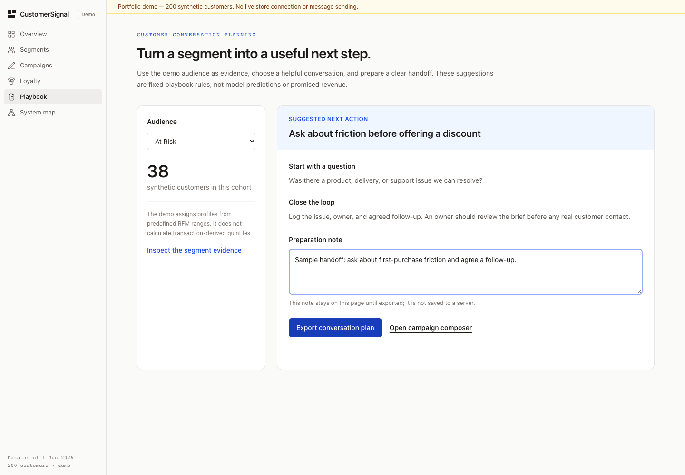
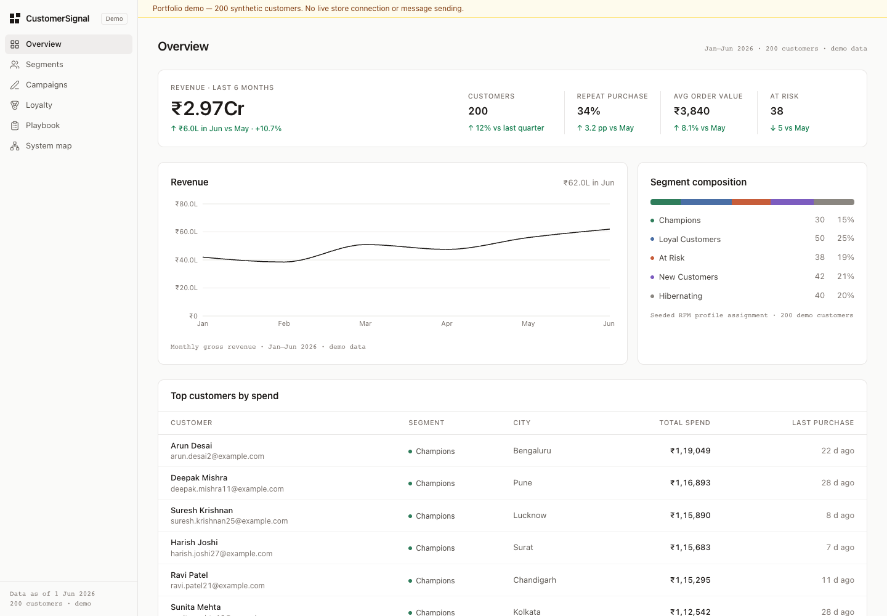
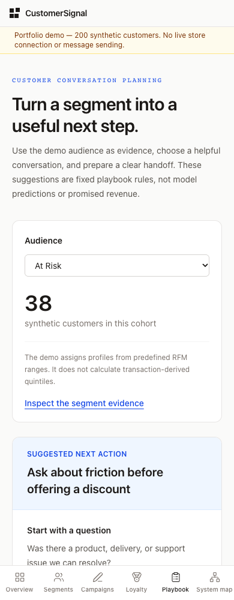

# CustomerSignal

A customer-retention workspace for understanding an audience before planning the next conversation.



## Try it locally

Requires Node.js 22.18 or newer.

```bash
git clone https://github.com/JecinElizabeth/CustomerSignal.git
cd CustomerSignal
npm ci
npm run dev
```

Open http://localhost:3000. No API key is needed for the demo. Do not add real customer data.

## What the demo does

- Explores 200 deterministic synthetic customer profiles across five RFM segments.
- Shows revenue summaries, loyalty tiers and a searchable member lookup.
- Builds a campaign brief with validated input and labelled local fallback templates.
- Turns a selected audience into a conversation plan: action, discovery question, follow-up and a preparation note.
- Exports that plan as CSV, escaping cell contents and neutralizing spreadsheet formula prefixes.
- Explains the browser/server boundary through the System map and [beginner guide](docs/BEGINNER_GUIDE.md).

The new retention playbook is the main learning path: open **Playbook**, select **At Risk**, inspect the evidence, write a preparation note and export a plan.

## Screenshots

| Conversation planning | Customer overview |
| --- | --- |
|  |  |



## How it works

```text
Seeded demo profiles -> server-rendered analytics -> browser views
Browser brief -> Next.js API -> validate/rate-limit -> optional model or local template
Browser playbook note -> spreadsheet-safe CSV download
```

Next.js and React render the application; TypeScript defines shared shapes; Zod checks campaign requests. The playbook uses explicit, fixed rules. It does not call an AI model. Campaign generation can optionally call Groq from the server when an owner supplies a key; all verification here used the no-key template path.

## Verification commands

```bash
npm run lint
npx tsc --noEmit
npm test
npm run build
npm audit
```

The automated CSV tests check multiline/quoted fields and formula-prefix handling. Browser QA checks the key pages, playbook selection, actual CSV download, mobile overflow and the server's valid/invalid campaign responses. Screenshots above were captured from the running application.

## Limits that matter

- All customers, financial figures and campaign performance ranges are illustrative demo values.
- RFM labels are assigned from predefined profile ranges; the app does not calculate quintiles from imported transactions.
- There is no store connector, authentication, shared customer database or message sending.
- Playbook notes remain in the open page until exported. They are not saved to a server.
- Model output still needs human review; output screening is a basic guard, not a security guarantee.
- In-memory rate limits reset when the server restarts and do not coordinate across multiple instances.
- Production use would need authentication, durable storage, privacy controls, tested integrations and stronger abuse controls.

## Files to read first

1. `lib/mock-data.ts` — synthetic profiles and summaries.
2. `components/PlaybookClient.tsx` — conversation workflow and export.
3. `lib/csv.ts` — safe spreadsheet export.
4. `app/api/generate-campaign/route.ts` — validation, optional provider and fallback.
5. [Beginner guide](docs/BEGINNER_GUIDE.md) — a 45-minute walkthrough and demo script.

Maintained by Jecin Elizabeth. Shared team-project adaptation with an independently maintained repository. Licensed under [MIT](LICENSE).
